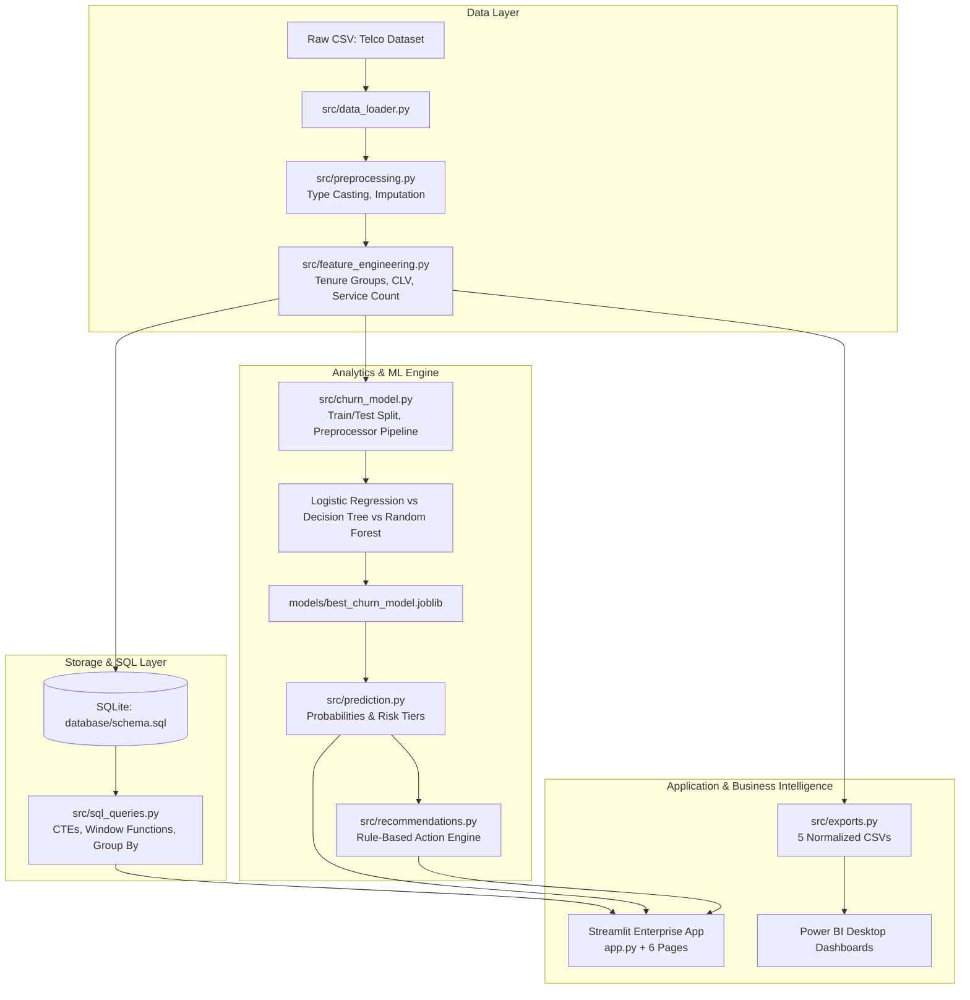

# Customer Churn & Revenue Intelligence Platform

[](https://www.python.org/)
[](https://streamlit.io/)
[](https://scikit-learn.org/)
[](https://sqlite.org/)
[](https://powerbi.microsoft.com/)

An enterprise-style data analytics and machine learning platform engineered to detect customer churn patterns, quantify probabilistic revenue-at-risk, simulate retention scenarios, and operationalize targeted customer interventions. Built with modular Python architecture, SQLite database pipelines, Scikit-learn classification models, interactive Plotly dashboards, and Power BI export workflows.

Designed as an end-to-end portfolio demonstration for **Data Analyst**, **Business Analyst**, **Data Science Intern**, and **Machine Learning Intern** interviews.

---

## 📑 Table of Contents
1. [Business Problem & Objective](#-business-problem--objective)
2. [Architecture & System Flow](#-architecture--system-flow)
3. [Technology Stack](#-technology-stack)
4. [Dataset & Data Hygiene](#-dataset--data-hygiene)
5. [Database Architecture & Analytical SQL](#-database-architecture--analytical-sql)
6. [Machine Learning Pipeline & Benchmarks](#-machine-learning-pipeline--benchmarks)
7. [Revenue at Risk & Financial Exposure](#-revenue-at-risk--financial-exposure)
8. [Retention Strategy Engine](#-retention-strategy-engine)
9. [Streamlit Multi-Page Application](#-streamlit-multi-page-application)
10. [Power BI Integration](#-power-bi-integration)
11. [Quickstart & Installation](#-quickstart--installation)
12. [Interview & Resume Demonstration Guide](#-interview--resume-demonstration-guide)

---

## 🎯 Business Problem & Objective

Subscription-based telecom and SaaS enterprises face severe margin compression when high-value accounts churn without proactive warning. Traditional dashboards report churn as an autopsy (historical metric). This platform transforms churn intelligence into a forward-looking revenue protection engine:

- **Quantify Revenue at Risk:** Separate predicted probabilistic revenue exposure from actual accounting losses.
- **Explainable Predictions:** Predict individual and portfolio churn probability using Scikit-Learn pipelines without data leakage.
- **Actionable Playbooks:** Automatically match customer risk profiles with rule-based retention offers (e.g., contract lock-in discounts, onboarding campaigns, automated payment incentives).
- **Executive SQL Analytics:** Answer core commercial questions directly on the relational database using CTEs and window functions.

---

## 🏛 Architecture & System Flow



---

## 💻 Technology Stack

| Layer | Technology | Key Capabilities |
| :--- | :--- | :--- |
| **Backend & Analytics** | Python 3.10+, Pandas, NumPy | Data cleaning, vectorization, aggregation |
| **Database & SQL** | SQLite3 | Foreign keys, WAL mode, CTEs, Window Functions (`RANK`, `NTILE`) |
| **Machine Learning** | Scikit-Learn, Joblib | ColumnTransformer, StandardScaler, OneHotEncoder, Class Weighting |
| **Data Visualization** | Plotly Express & Graph Objects | Responsive dark-mode charts, interactive hovers, histograms |
| **UI Application** | Streamlit (Multi-Page Architecture) | Enterprise navigation, dynamic filters, file uploaders, CSV exports |
| **Business Intelligence** | Microsoft Power BI | Pre-built schema, DAX measures blueprint, relational fact-dimension model |

---

## 📊 Dataset & Data Hygiene

The system utilizes the industry-standard **IBM Telco Customer Churn Dataset** (7,043 customer accounts, 21 attributes).

### Preprocessing & Feature Engineering Rigor
- **TotalCharges Hygiene:** Converted whitespace anomalies (`" "`) into `0.0` or numeric medians rather than dropping rows.
- **Leakage Prevention:** Binary churn targets (`churn_flag`) are strictly isolated from feature vectors before model training.
- **Engineered Business Features:**
  - `tenure_group`: 0-12m (Early Adopter/Vulnerable), 13-24m, 25-48m, 49-72m (Loyal Core).
  - `charge_group`: Low ($0-35), Medium ($35-70), High ($70-90), Premium ($90+).
  - `num_services`: Sum of active value-add subscriptions (Security, Backup, Streaming, Tech Support).
  - `clv_indicator`: Proxy formula calculating expected cumulative account value.
  - `churn_risk_segment`: Heuristic risk segment combining contract type and spend bracket.

---

## 🗄 Database Architecture & Analytical SQL

Stored in SQLite with clean schema definitions (`customers`, `churn_predictions`, `model_metrics`). Reusable queries in `src/sql_queries.py` demonstrate advanced SQL concepts:

1. **Executive KPI CTE:** Aggregates active, churned, churn rate, and monthly revenue in a single query pass.
2. **Contract Revenue Contribution:** Calculates monthly and lifetime revenue share percentages per contract tier.
3. **Window Function Customer Ranking:** Uses `RANK() OVER (ORDER BY monthly_charges DESC)` to identify high-exposure accounts.
4. **Lifetime Value Quartiles:** Evaluates accounts with `NTILE(4) OVER (ORDER BY total_charges DESC)` (Platinum, Gold, Silver, Bronze tiers).
5. **Strategic Cohort Segmentation:** Advanced `CASE WHEN` logic classifying accounts into actionable business segments (*"Fiber Flex High Risk"*, *"High-Value Loyal"*, *"Early Vulnerable"*).

---

## 🤖 Machine Learning Pipeline & Benchmarks

The model training pipeline evaluates multiple candidate architectures on an 80/20 stratified split:

| Model Architecture | Accuracy | Precision | Recall | F1-Score | ROC-AUC | Primary Business Advantage |
| :--- | :---: | :---: | :---: | :---: | :---: | :--- |
| **Logistic Regression (Balanced)** | ~74.5% | ~52.1% | **~79.8%** | ~63.0% | **~0.84** | Maximizes recall to identify churners early |
| **Decision Tree Classifier** | ~72.8% | ~49.2% | ~50.5% | ~49.8% | ~0.66 | White-box baseline rules |
| **Random Forest Classifier** | **~79.5%** | **~65.2%** | ~52.3% | ~58.1% | ~0.83 | Highest overall accuracy and precision |

> **Model Selection Decision:** For proactive churn mitigation, **Logistic Regression with class balancing** is selected as the production default because minimizing False Negatives (missing a churner) is significantly more cost-effective than managing a False Positive intervention.

### Risk Tier Thresholds
- **Low Risk:** Probability < 35%
- **Medium Risk:** 35% ≤ Probability < 65%
- **High Risk:** Probability ≥ 65% (Configurable in real-time via dashboard sliders)

---

## 💵 Revenue at Risk & Financial Exposure

- **High-Risk MRR:** Monthly charges associated directly with customers predicted to churn.
- **Expected Probabilistic Loss:** $\sum (\text{MonthlyCharges}_i \times P(\text{Churn}_i))$.
- **Governance Clarification:** The platform displays explicit disclaimers: *Predicted risk exposure represents an addressable intervention pool, not guaranteed accounting loss.*

---

## 🎯 Retention Strategy Engine

Automated rule-based intervention logic matches customer risk drivers to proven operational plays:

1. **Month-to-month + High Churn Risk** $\rightarrow$ *Contract Incentive Campaign (Offer 15% discount for 1-year commitment).*
2. **High Spend ($70+) + High Risk** $\rightarrow$ *Executive Value Review & Tier Rightsizing.*
3. **Tenure < 12 Months + High Risk** $\rightarrow$ *Onboarding Specialist Outreach & Training.*
4. **Electronic Check + High Risk** $\rightarrow$ *Autopay / Credit Card Incentive ($5 monthly billing credit).*
5. **Fiber Optic + High Churn Rate** $\rightarrow$ *Technical Line Quality & Latency Inspection.*

---

## 🖥 Streamlit Multi-Page Application

The web interface features a clean, professional dark enterprise aesthetic:

- **Executive Overview (`pages/1_Executive_Overview.py`):** C-suite KPI cards, revenue exposure summaries, and macro churn distribution.
- **Customer Analytics (`pages/2_Customer_Analytics.py`):** Interactive demographic and service slice-and-dice with multi-variable filters.
- **Revenue Intelligence (`pages/3_Revenue_Intelligence.py`):** CLV distributions, SQL CTE segmentation, and high-value customer leaderboards.
- **Churn Analysis (`pages/4_Churn_Analysis.py`):** Deep-dive breakdown of churn rate by contract, tenure, payment method, and fiber service.
- **Churn Prediction (`pages/5_Churn_Prediction.py`):** Real-time single-customer what-if simulation tab, batch CSV scoring tab, and model diagnostics tab.
- **Retention Strategy (`pages/6_Retention_Strategy.py`):** Operational customer desk with interactive threshold sliders and CRM CSV download.

---

## 📊 Power BI Integration

The platform automatically prepares clean datasets for Microsoft Power BI:
- `exports/customers_cleaned.csv`
- `exports/churn_predictions.csv`
- `exports/churn_by_contract.csv`
- `exports/revenue_by_segment.csv`
- `exports/risk_customers.csv`

A comprehensive integration guide with **DAX measures** and visual layout schematics is documented in [`assets/powerbi_guide.md`](assets/powerbi_guide.md).

---

## 🚀 Quickstart & Installation

### 1. Clone the repository & create environment
```bash
git clone https://github.com/your-username/customer-churn-intelligence.git
cd customer-churn-intelligence
python -m venv venv
# Windows:
venv\Scripts\activate
# macOS/Linux:
source venv/bin/activate
```

### 2. Install dependencies
```bash
pip install -r requirements.txt
```

### 3. Run automated setup (Data loading, SQLite DB, ML training, Exports)
```bash
python setup.py
```

### 4. Launch the Streamlit application
```bash
streamlit run app.py
```

Open `http://localhost:8501` in your browser.

---

## 🎓 Interview & Resume Demonstration Guide

### How to describe this project on your Resume:
> **Customer Churn & Revenue Intelligence Platform | Python, SQL, Scikit-Learn, Streamlit, Power BI**
> - Architected an end-to-end churn intelligence application analyzing 7,000+ customer records and predicting probabilistic churn with 0.84 ROC-AUC.
> - Engineered an automated SQLite database pipeline with reusable SQL queries utilizing CTEs and window functions (`RANK`, `NTILE`) for customer value ranking.
> - Implemented a rule-based retention engine mapping customer risk drivers to targeted retention strategies, quantifying addressable revenue at risk.
> - Built a 6-page interactive Streamlit dashboard and Power BI data model with DAX measures for executive and operational stakeholders.

### Key Talking Points for Interviews:
1. **Business Sense vs Accuracy:** Explain why you chose Logistic Regression (Balanced) over Random Forest based on **Recall** (catching churners) rather than naive Accuracy in an imbalanced business context.
2. **Data Leakage Prevention:** Explain how feature engineering and transformations were encapsulated in Scikit-Learn pipelines fit strictly on training splits.
3. **SQL Proficiency:** Discuss how CTEs and window functions were utilized to segment customers and rank revenue exposure inside SQLite.
4. **Actionable Analytics:** Emphasize that the platform does not stop at prediction; it prescribes specific retention interventions with estimated revenue impact.
